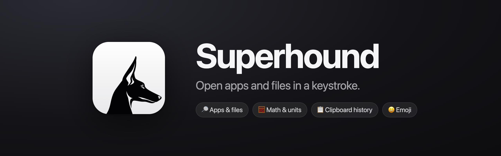

<div align="center">

<a href="https://superhound.app"></a>

<br>

[](https://github.com/PGHQdev/Superhound/releases/latest)
[](#-install)
[](#-install)
[](#-privacy)
[](https://superhound.app)
[](LICENSE)

### The fast Spotlight alternative for your Mac

Press one shortcut. Type a few letters. Your app, file, answer, or emoji is already there.

**[Install](#-install)** · **[Website](https://superhound.app)** · **[Docs](https://superhound.app/docs)** · **[Buy a license](https://superhound.app/buy)**

</div>

<br>

## ✨ Why Superhound

| | |
|---|---|
| ⚡ **Fast** | Searches 100,000 items in about 10 ms. Results appear while you type. |
| 🪶 **Light** | Under 1 MB on disk, about 40 MB of memory. Native Mac code, no web views. |
| 🔒 **Private** | Works offline. Reads file names, never file contents. No account, no tracking. |
| 🧠 **Smart** | Forgives typos, ignores accents, and learns which results you open. |
| 💸 **Fair** | $15 once for 3 Macs. No subscription. Free to try with every feature. |

## 🔎 What you can do

| | Type | Press Return to |
|---|---|---|
| 🚀 **Open apps and files** | `term`, `safri`, `notes.txt` | Open it |
| ⚙️ **Go to System Settings** | `storage`, `displays` | Open the pane |
| 🧮 **Calculate** | `48*12`, `15% of 240`, `240 + 15%` | Copy the answer |
| 📏 **Convert units** | `5 km to mi`, `72f to c` | Copy the answer |
| 😀 **Find emoji** | `fire`, `happy`, `japan` | Copy the emoji |
| 💤 **Run commands** | `sleep`, `restart`, `mute`, `dark`, `empty trash` | Run it |
| 📋 **Paste from clipboard history** | Press ⌥⌘V | Paste it |

## 📦 Install

Paste this in Terminal:

```sh
curl -fsSL https://superhound.app/install | sh
```

That's it. Superhound downloads, checks the download against its published SHA-256, goes into `~/Applications`, and opens. The hound appears in your menu bar.

Superhound is free to try with every feature, and it shows a reminder now and then. A license is **$15 once for 3 Macs** at [superhound.app](https://superhound.app). To activate, choose **Enter License…** from the menu bar.

> [!TIP]
> Want Superhound on ⌘Space? See [Open Superhound with ⌘Space](#open-superhound-with-space).

## ⌨️ Keys

| Key | Action |
|---|---|
| ⌘Space | Open Superhound (after the [setup](#open-superhound-with-space)) |
| ⌥⌘V | Open clipboard history |
| ↑ ↓ | Select a result |
| Return | Open, run, copy, or paste the result |
| ⌘Return | Show a file in Finder. In clipboard history: copy only |
| ⌘K | All actions: Open With, Quick Look, Copy Path, Move to Trash, and more |
| ⌘Y | Quick Look |
| ⇧⌘C | Copy path |
| Esc | Close |

Right-click a result for the same actions as ⌘K. Click the logo at the bottom of the panel for the menu.

## 🔒 Privacy

Superhound works offline. It makes only two kinds of network request:

- **A daily update check.** It carries no license key and no device ID. Turn it off with **Check for Updates Automatically**.
- **License activation.** It sends your license key and a one-way device ID to superhound.app, once.

Superhound reads file names, never file contents. All its data stays on your Mac in `~/Library/Application Support/Superhound/`.

## ❓ FAQ

<details>
<summary><b>Is Superhound a Spotlight alternative?</b></summary>

<br>

Yes. Superhound opens apps, files, and System Settings panes like Spotlight, and it adds a calculator, unit conversion, emoji search, system commands, and a clipboard history. You can put it on ⌘Space in place of Spotlight.

</details>

<details>
<summary><b>How much does it cost?</b></summary>

<br>

Superhound is free to try, with every feature and a reminder. A license is a one-time payment of $15 for 3 Macs. Refunds are open for 14 days, for any reason.

</details>

<details>
<summary><b>Which Macs does it run on?</b></summary>

<br>

Macs with Apple Silicon (M1 or later) and macOS 15 or later.

</details>

<details>
<summary><b>Is it open source?</b></summary>

<br>

Yes. The full source is here under the AGPL-3.0 license. You can [build it yourself](#build-from-source).

</details>

<details>
<summary><b>Is it finished?</b></summary>

<br>

Superhound is an early version. It checks for updates once a day, and you install one with a click.

</details>

## 📖 Guide

<details id="open-superhound-with-space">
<summary><b>Open Superhound with ⌘Space</b></summary>

<br>

Spotlight uses ⌘Space, so macOS needs two changes in **System Settings → Keyboard → Keyboard Shortcuts**:

1. In **App Shortcuts**, add a shortcut for **Superhound** with the menu title `Search` and the keys ⌘Space.
2. In **Spotlight**, turn off **Show Spotlight search**.

Then open **Settings…** from the menu bar and click **Retry**. To get Spotlight back, quit Superhound and turn **Show Spotlight search** on again.

</details>

<details>
<summary><b>Search your folders</b></summary>

<br>

Superhound always searches your app folders. To search your own folders, add them in **Settings…**. No personal folder is added for you.

- Changes to files appear in a few seconds. **Refresh Catalog** scans everything now.
- It skips hidden items, the inside of packages, online-only files, and generated folders such as `node_modules`. You can turn off the generated-folder rule.
- Removing a location never deletes files.

You can change both shortcuts in **Settings…**.

</details>

<details>
<summary><b>Clipboard history</b></summary>

<br>

Superhound keeps the last 500 pieces of text you copy, newest first. Press ⌥⌘V, or choose **Clipboard History** in the menu bar, then type to filter. A normal search of 3 or more characters also shows up to 2 matching copies.

It does not keep:

- copies that password managers mark as private
- copies from Keychain Access and Passwords
- text longer than 100,000 characters

**Clear Clipboard History** in the menu bar deletes it all.

</details>

<details>
<summary><b>Licenses</b></summary>

<br>

To activate, click **Activate license** at the bottom of the panel, or choose **Enter License…** in the menu bar. To move a license to another Mac, choose **Deactivate License…** on the old Mac first. To get your key again, go to [superhound.app/license](https://superhound.app/license).

</details>

<details>
<summary><b>Updates</b></summary>

<br>

Superhound checks for a new version once a day. When there is one, the panel shows **Update to** and the menu shows **Update to…**. Superhound downloads the update, checks that it has the Superhound signature, and opens again. It keeps the previous version in `~/Applications/.superhound-backup.*`. To go back, quit Superhound and put that `previous.app` in place of `~/Applications/Superhound.app`.

To turn off the daily check, turn off **Check for Updates Automatically** in the menu. **Check for Updates…** checks at once.

</details>

<details>
<summary><b>Permissions</b></summary>

<br>

| Permission | When macOS asks | Without it |
|---|---|---|
| Accessibility | When you paste from clipboard history | Return copies the text, and you paste it yourself |
| Automation for Finder, System Events, or the login window | The first use of a command such as Empty Trash or Restart | That command does not run |

Restart, Shut Down, and Log Out show the macOS confirmation first. Empty Trash asks first. Lock Screen uses a private macOS call that a later macOS can break.

</details>

<details>
<summary><b>Your data</b></summary>

<br>

| File | Content |
|---|---|
| `folders.plist` | Your search locations |
| `catalog.sqlite` | The list of indexed names. Safe to delete; Superhound builds it again. |
| `usage.plist` | The results you opened and what you typed for them |
| `clipboard.plist` | Your clipboard history, readable only by your macOS user |
| `license.plist` | Your license key and this Mac's activation, readable only by your macOS user |
| `performance.jsonl` | Timing records |

</details>

<details>
<summary><b>Uninstall</b></summary>

<br>

Choose **Uninstall Superhound…** in the menu bar. Superhound frees this Mac's license activation, gives ⌘Space back to Spotlight if it took it, deletes its settings and data, and moves itself to the Trash.

If the app does not open, paste this in Terminal. It does the same:

```sh
curl -fsSL https://superhound.app/uninstall | sh
```

If you dragged Superhound to the Trash, Spotlight's ⌘Space stays off. Run the command above, or turn on **Show Spotlight search** in **System Settings → Keyboard → Keyboard Shortcuts → Spotlight**.

</details>

## 🛠️ For developers

<details id="build-from-source">
<summary><b>Build from source</b></summary>

<br>

You need the Apple Command Line Tools (`xcode-select --install`). Nothing else.

```sh
git clone https://github.com/PGHQdev/superhound.git
cd superhound
scripts/build.sh
scripts/install.sh .build/Superhound.app
open ~/Applications/Superhound.app
```

A build from source cannot update itself. To update it, pull the latest code, quit Superhound, and run the same build and install commands. It has a local signature, so macOS can ask for Accessibility again after you install a new build. If paste stops working, remove Superhound in **System Settings → Privacy & Security → Accessibility** and add it again.

</details>

<details>
<summary><b>Performance</b></summary>

<br>

Measured on an Apple M1 with macOS 15.

| Measure | Result |
|---|---|
| App size | 900 KiB |
| Memory after launch | 28 to 42 MiB over 20 minutes |
| Search across 100,000 items | 9.6 ms median, 20.3 ms at the 95th percentile |

The search time comes from a synthetic benchmark. The methods and all results are in [docs/prototype-validation.md](docs/prototype-validation.md).

</details>

<details>
<summary><b>Code and tests</b></summary>

<br>

Superhound is written in Objective-C and C with AppKit, SQLite, and FSEvents. It has no third-party dependencies.

```sh
scripts/test.sh       # ten test suites with AddressSanitizer and UndefinedBehaviorSanitizer
scripts/benchmark.sh  # search and catalog speed at 10,000 and 100,000 items
tests/install.sh      # installer checks; quit Superhound first
```

| Folder | Content |
|---|---|
| `core/` | Search, ranking, scanning, the catalog, calculator, emoji, and clipboard history. No window code. |
| `app/` | The panel, the settings window, shortcuts, and macOS actions |
| `tests/` | Test suites for `core/` and the installer |
| `bench/` | Benchmark programs |
| `scripts/` | Build, test, install, release, and benchmark |

[AGENTS.md](AGENTS.md) describes each file. The first design and plan are in [docs/superpowers](docs/superpowers).

</details>

## 📄 License

Copyright (C) 2026 PGHQdev. Superhound is free software under the GNU Affero General Public License, version 3. See [LICENSE](LICENSE).

<div align="center">

<br>

**[superhound.app](https://superhound.app)** · Made for the Mac 🐕

</div>
